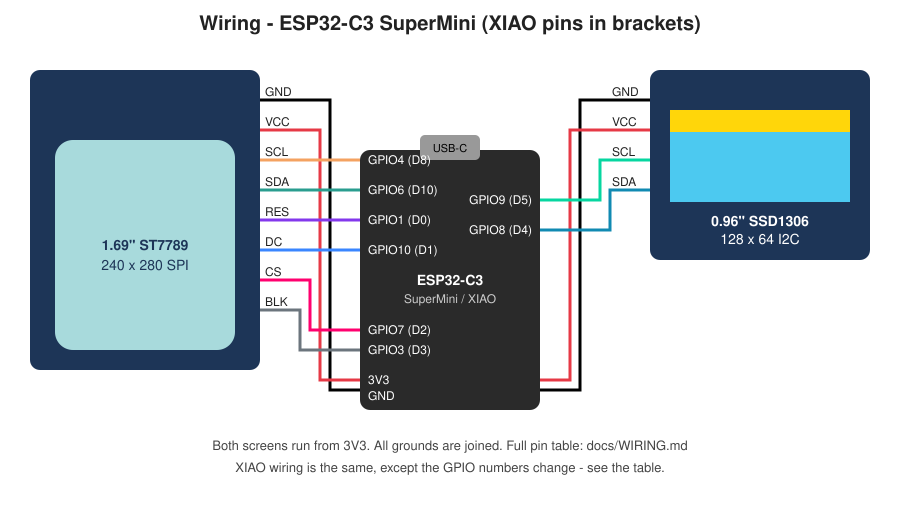

# Electronic Business Card (dual screen, credit-card size)

A cheap DIY electronic business card built on perfboard: a **colour screen
showing your photo** next to a **small OLED with your name, email and a
QR code**, driven by an ESP32-C3. A **button** flips between scenes, and a small
**rechargeable battery** on the back means it works without a cable. It
fits inside a credit card's footprint (85.6 × 54 mm).

```
            70 mm (5×7 cm perfboard)
 ┌──────────────────────────────────────────────┐
 │ GND VCC SCL SDA RES DC CS BLK   GND VCC SCL SDA│
 │ ┌──────────────┐        ┌──────────────────┐ │
 │ │              │        │ you@email.com    │ │  50 mm
 │ │   1.69" TFT  │        │   Your Name      │ │
 │ │  your photo  │        │   engineer :3    │ │
 │ │              │        └──────────────────┘ │
 │ │              │  ┌─┐   ┌──────────┐         │
 │ │              │  │◉│   │ XIAO C3  │▐ USB-C  │
 │ └──────────────┘  └─┘   └──────────┘         │
 └──────────────────[▐]─────────────────────────┘
            button ◉    [▐] on/off switch    (LiPo on the back)
```

## Controls

| Button | Does |
|---|---|
| **Tap** | Next scene: **photo + name** → **big QR code + "scan me"** → **info card + contact** → your other photos → back to the start |
| **Hold 1 s** | Both screens off, low-power sleep. Tap to wake |

The slide switch on the edge cuts the battery completely.

| | |
|---|---|
| **Cost** | about **£15** with battery, or **£7–9** USB-only ([BOM](docs/BOM.md)) |
| **Size** | 70 × 50 mm, about 12–14 mm thick (credit card = 85.6 × 54 mm) |
| **Battery** | 250 mAh LiPo, about 4 h with the screens on, charges over USB-C |
| **Skill** | beginner soldering, about 2–3 hours |
| **Software** | Arduino IDE, plus a small Python script for your photo |

## Contents

1. [Parts list and prices](docs/BOM.md)
2. [Wiring](docs/WIRING.md) ([diagram](docs/wiring.svg))
3. [Perfboard layout and build steps](docs/BUILD.md)
4. [Firmware: install, customise and flash](#firmware)
5. [Troubleshooting](docs/TROUBLESHOOTING.md)



## Parts (short version)

| Part | Pick | Approx. price |
|---|---|---|
| Microcontroller | Seeed XIAO ESP32-C3 (built-in battery charger) | £5–6 |
| Colour screen | 1.69" ST7789 240×280 SPI IPS, 8-pin | £3 |
| Info screen | 0.96" SSD1306 128×64 I2C OLED, 4-pin (yellow/blue) | £1.50 |
| Battery | 3.7 V LiPo 250 mAh, flat (302030) | £2–3 |
| Button + switch | 6×6 mm tactile button, SS12D00 slide switch | £0.20 |
| Board | 5×7 cm double-sided perfboard | £0.30 |
| Wire + headers | 30 AWG wire-wrap wire, pin headers | £0.50 |

**Cheaper (~£7–9):** use an ESP32-C3 SuperMini and skip the battery. It
then runs only while plugged in over USB-C, but the button still works.
Full details: **[docs/BOM.md](docs/BOM.md)**.

## Firmware

### 1. Set up the Arduino IDE

1. Install the [Arduino IDE 2](https://www.arduino.cc/en/software).
2. Open **File → Preferences → Additional boards manager URLs** and add
   `https://espressif.github.io/arduino-esp32/package_esp32_index.json`
3. Open **Tools → Board → Boards Manager**, search **esp32** and install
   *esp32 by Espressif Systems*.
4. Open **Tools → Manage Libraries** and install:
   - `Adafruit ST7735 and ST7789 Library`
   - `Adafruit SSD1306`
   - `Adafruit GFX Library` (it usually installs automatically with the two above)

### 2. Add your details

Open `firmware/business_card/business_card.ino`. Then, in the
`config.h` tab:

- pick your board (`BOARD_XIAO_ESP32C3`, the default, or `BOARD_ESP32C3_SUPERMINI`)
- fill in your name, title, email and website
- optional: set `AUTO_ADVANCE_MS` to make it also change scene by itself

### 3. Add your photo and QR code (optional, but that's the fun part)

```bash
pip install -r tools/requirements.txt
python3 tools/make_assets.py --photo me.jpg --qr https://github.com/yourname
```

This creates `photo.h` and `qr.h` inside `firmware/business_card/`. The
photo is cropped and resized for you. Give `--photo` several files for a
slideshow. Without these files the card shows a gradient with your
initials instead.

> `photo.h` and `qr.h` are listed in `.gitignore`, so your photo doesn't end
> up in a public repo by accident.

### 4. Flash it

1. Plug the board in with a USB-C **data** cable.
2. Choose **Tools → Board**:
   - XIAO: **XIAO_ESP32C3**
   - SuperMini: **ESP32C3 Dev Module**, then set **USB CDC On Boot → Enabled**
3. Choose the port and click **Upload**. Make sure the card is **awake**:
   while it's asleep (after holding the button), USB uploads won't connect.
4. If the upload won't start, hold **BOOT**, tap **RESET**, release **BOOT**,
   then upload again.

## Make it yours

- **Different screens:** for a 1.54" 240×240 screen, set `TFT_HEIGHT 240` and
  run the script with `--height 240`.
- **Scenes:** the list of scenes is built in `buildScenes()` in
  `business_card.ino`. Add a new `SceneType`, draw it in `showScene()` and
  `oledShow()`, and add it to the list.
- **Brightness:** lower `TFT_BRIGHTNESS` in `config.h` for longer battery
  life.
