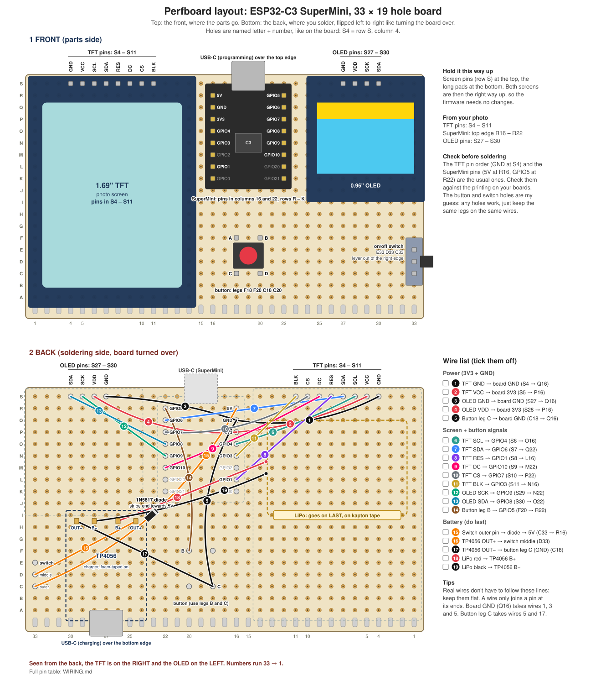

# Build guide

## Perfboard layout

The board is a 5×7 cm perfboard (24 × 18 holes, 2.54 mm pitch) used in
landscape. The screens, SuperMini, button and switch go on the **front**.
The wires run on the **back**, with the battery and the TP4056 charger stuck
flat on top of them (insulated with tape).

The diagram shows both sides. The **back view is mirrored**, as if you'd
turned the board over, so it matches what you see while soldering. Every
wire is numbered: tick them off in the wire list as you go.

Hole positions are given as (column, row) **seen from the front**:

- **TFT:** 8-pin header in row 1, columns 3–10. Put a strip of foam tape
  under the bottom edge of the screen module so it doesn't wobble.
- **OLED:** 4-pin header in row 1, columns 17–20.
- **SuperMini:** lying sideways in the bottom right, with pins in rows 12
  and 18, columns 16–23. Its USB-C hangs over the right edge, for
  programming.
- **Button:** legs at columns 13 and 15, rows 13 and 15, in the gap between
  the TFT and the SuperMini.
- **Slide switch:** row 18, columns 5–7, with the lever sticking out of the
  bottom edge.
- **TP4056 (back):** under the TFT, with its USB-C over the left edge (as
  seen from the front), so the two USB-C ports are easy to tell apart
  (charging vs programming).
- **LiPo (back):** under the OLED, fitted last, on kapton tape.
- Module sizes vary a little between sellers. The diagram assumes a
  30 × 37 mm TFT board, a 27 × 27 mm OLED board and a 22.5 × 18 mm
  SuperMini. Lay everything out **before** soldering, and move a part by a
  hole if it doesn't fit.

## Step by step

1. **Check the parts.** Before soldering, plug both screens and the button
   into a breadboard with jumper wires (same pins as
   [WIRING.md](WIRING.md)), flash the firmware and check that both screens
   light up and the button changes scenes. Do this on USB power only, **no
   battery yet**.
2. **Solder headers** onto the SuperMini (short male headers). Keep them
   straight by pushing them into the perfboard while you solder.
3. **Place the parts.** Push the screens, the SuperMini, the button and
   the switch through the perfboard. Bend one leg of each part to hold it, and check that the
   outline still fits within 85 × 54 mm.
4. **Solder all the pins** from the back.
5. **Run the power rails.** Use two wires: **3V3** to TFT VCC and OLED VCC,
   and **GND** to TFT GND, OLED GND and one leg of the button.
6. **Run the signal wires** one at a time using the table in
   [WIRING.md](WIRING.md), ticking each one off as you go. Keep the wires
   flat. The battery is going on top of them.
7. **Check for shorts** with the multimeter's continuity mode:
   - 3V3 to GND: must **not** beep
   - 5V to GND: must **not** beep
   - each wire end to end: **must** beep
8. **Test on USB** (still no battery). Check that the photo and name show,
   and that the button works.
9. **Fit the charger and battery.** See [WIRING.md](WIRING.md#battery-supermini--tp4056).
   1. Cover the back wiring with kapton or electrical tape.
   2. Solder the **1N5817 diode** (a 1N5818 or 1N5819 works too) from the switch's **outer** pin to the
      SuperMini's **5V** pin. The **stripe end goes towards 5V**.
   3. Wire TP4056 **OUT+** to the switch's **middle** pin, and **OUT−** to
      **GND**.
   4. Stick the TP4056 to the back with foam tape, with its USB-C over the
      edge.
   5. **Last:** solder the LiPo's **red** wire to **B+**, then its **black**
      wire to **B−**. Do one wire at a time so the bare ends never touch.
   6. Stick the battery down with foam tape.
10. **Finish.** Flip the switch on and it should boot from battery. Plug
    USB-C into the **TP4056** to charge (red LED = charging, blue/green =
    full).

## Keeping it thin

- The battery is 3 mm, the board 1.6 mm, and the TFT on its header about
  6–8 mm, so the card is about 12–14 mm thick in total.
- To go thinner, solder the SuperMini **flat** using its castellated edge
  pads, and solder the screens' header pins with the plastic spacer slid
  off.
