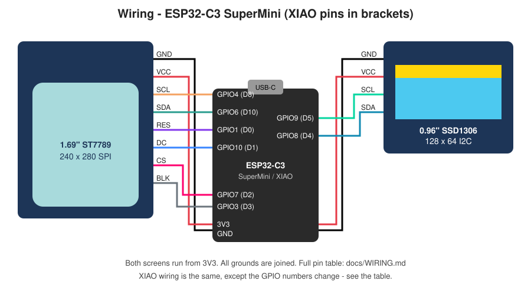

# Wiring



Every connection, for both supported boards. **GPIO numbers are what the
firmware uses** (see `firmware/business_card/config.h`).

## Colour TFT (1.69" ST7789, SPI)

| TFT pin | Function | ESP32-C3 SuperMini | XIAO ESP32-C3 |
|---|---|---|---|
| GND | Ground | GND | GND |
| VCC | Power | 3V3 | 3V3 |
| SCL | SPI clock (SCK) | GPIO4 | D8 (GPIO8) |
| SDA | SPI data (MOSI) | GPIO6 | D10 (GPIO10) |
| RES | Reset | GPIO1 | D0 (GPIO2) |
| DC | Data/command | GPIO10 | D1 (GPIO3) |
| CS | Chip select | GPIO7 | D2 (GPIO4) |
| BLK | Backlight (PWM) | GPIO3 | D3 (GPIO5) |

> The labels "SCL/SDA" on the TFT are misleading: this screen uses **SPI**,
> not I2C. SCL = clock and SDA = data in.

## Info OLED (0.96" SSD1306, I2C)

| OLED pin | ESP32-C3 SuperMini | XIAO ESP32-C3 |
|---|---|---|
| GND | GND | GND |
| VCC | 3V3 | 3V3 |
| SCL | GPIO9 | D5 (GPIO7) |
| SDA | GPIO8 | D4 (GPIO6) |

> **Check your OLED's pin order.** Some boards are `VCC GND SCL SDA`. Swapping
> VCC and GND can kill the screen.

## Button

| Button leg | ESP32-C3 SuperMini | XIAO ESP32-C3 |
|---|---|---|
| one side | GPIO5 | D7 (GPIO20) |
| other side | GND | GND |

No resistor is needed, because the chip's internal pull-up is used. A
6×6 mm tactile button has 4 legs, which are **connected in pairs** along
the long side. Wire across the button **diagonally** (opposite corners)
and it will always be right.

- **Tap:** next scene (changes both screens)
- **Hold 1 s:** screens off and low-power sleep. **Tap** to wake.
- **No presses for 5 minutes:** turns itself off (the same sleep).
- The last page in the cycle is a **help page** that explains all of this.

## Battery (SuperMini + TP4056)

```
 LiPo red (+)   ── TP4056 B+
 LiPo black (−) ── TP4056 B−
 TP4056 OUT+    ── switch middle pin
 switch outer pin ── 1N5817 diode ──▶|── SuperMini 5V pin
                    (1N5818 or 1N5819 work exactly the same)
                    (stripe/band end points TOWARDS the 5V pin)
 TP4056 OUT−    ── SuperMini GND
```

- **Charge** by plugging USB-C into the **TP4056**. The red LED means
  charging, blue/green means full. The card can be on or off while it
  charges.
- **Program** through the **SuperMini's** USB-C as usual. The diode stops
  USB's 5 V from being pushed back into the battery, so leaving the switch
  on is fine.
- The 5 V pin goes through the SuperMini's own regulator to make 3.3 V,
  so a LiPo (3.0–4.2 V) works fine. The card shuts off cleanly when the
  battery gets low (about 3.4–3.5 V), which protects the battery.
- **Polarity matters.** Red goes to B+. Many cheap LiPos have the JST wires
  the "wrong" way round, so trust the wire colours and a multimeter, not the
  plug.
- Never let the bare battery wires touch. Cut and solder them **one at a
  time**.

### Using a XIAO instead

The XIAO has the charger built in. Skip the TP4056 and the diode: LiPo red →
switch middle pin, switch outer pin → **BAT+** pad, and LiPo black → **BAT−**
pad. Both pads are on the underside of the XIAO, so solder the wires on
before mounting it. Charge through the XIAO's USB-C.

## Board pinouts (top view, USB-C at the top)

```
          ESP32-C3 SuperMini
             ┌──[USB-C]──┐
  (diode) 5V ●           ● GPIO5   BUTTON
          GND ●           ● GPIO6   TFT SDA
          3V3 ●           ● GPIO7   TFT CS
  TFT SCL GPIO4 ●         ● GPIO8   OLED SDA
  TFT BLK GPIO3 ●         ● GPIO9   OLED SCL
  (spare) GPIO2 ●         ● GPIO10  TFT DC
  TFT RES GPIO1 ●         ● GPIO20  (spare)
  (spare) GPIO0 ●         ● GPIO21  (spare)
             └───────────┘


          Seeed XIAO ESP32-C3
             ┌──[USB-C]──┐
  TFT RES  D0 ●           ● 5V
  TFT DC   D1 ●           ● GND      ← all grounds
  TFT CS   D2 ●           ● 3V3      ← both screens' VCC
  TFT BLK  D3 ●           ● D10  TFT SDA
  OLED SDA D4 ●           ● D9   (spare)
  OLED SCL D5 ●           ● D8   TFT SCL
  (spare)  D6 ●           ● D7   BUTTON
             └───────────┘
        [BAT+] [BAT−] pads on the underside
```

XIAO summary: D0 RES · D1 DC · D2 CS · D3 BLK · D4 OLED SDA · D5 OLED SCL ·
D7 button · D8 TFT SCL · D10 TFT SDA.

**Board revisions differ, so always check the silkscreen on your board**
before soldering. If the pins differ, change the numbers in `config.h`.

## Power

- Both screens are powered from **3V3**. They draw about 30–60 mA together.
- All grounds are joined.
- Runs from the battery (via the TP4056 and diode into 5V) or from the
  SuperMini's USB-C.
- USB-C on the TP4056 charges the battery.

## Notes on pin choices

- The TFT and the OLED are on **separate buses** (SPI vs I2C), so they can't
  conflict.
- On the ESP32-C3, GPIO2, 8 and 9 are boot-strapping pins. They're used here
  only for signals that sit high at power-up, so the board boots normally.
- The button is on a pin that is **not** a strapping pin, so holding it while
  plugging in won't put the board into bootloader mode.
